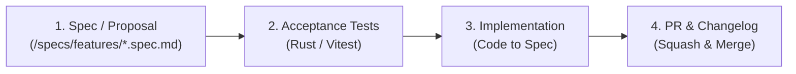

# Contributing to MemCard Cloud

Thank you for your interest in contributing to **MemCard Cloud**! We follow **Spec-Driven Development (SDD)**, strict code quality standards, and full transparency in AI collaboration.

---

## 1. Spec-Driven Development (SDD) Workflow

All feature work is driven by specifications in the [`specs/`](./specs) directory.



1. **Spec-First:** Before writing code for a new feature, author or update a spec under `specs/features/` based on `specs/template.spec.md`.
2. **Contract Synchronization:** If adding or changing a Tauri IPC command or event, update `specs/contracts/` in the same commit.
3. **Traceability:** Link your Pull Request to the relevant spec.

---

## 2. AI Collaboration & Transparency Policy

We embrace AI assistants (Antigravity, Cursor, Claude Code, Copilot, etc.) to enhance developer velocity. However, we strictly require transparency and human accountability:

1. **Commit Co-Authorship:**
   Every git commit created with the help of an AI assistant must include the standard git trailer:
   ```git
   Co-authored-by: AssistantName <email@example.com>
   ```
2. **PR Disclosure:**
   In your Pull Request, check the AI Collaboration disclosure box in the template and state which tools were used.
3. **Human Responsibility:**
   All AI-assisted code must be reviewed, executed, and tested locally by a human before opening a PR.

---

## 3. Branching & Commit Conventions

### Branch Naming
- Features: `feat/<spec-id>-<short-description>` (e.g. `feat/01-fs-watcher-debounce`)
- Fixes: `fix/<issue-id>-<short-description>` (e.g. `fix/14-file-lock-check`)
- Documentation: `docs/<short-description>`
- Maintenance: `chore/<short-description>`

### Commit Messages
We follow the [Conventional Commits](https://www.conventionalcommits.org/) specification:
- `feat(scope): add 3-second debounce to watcher`
- `fix(core): correct hash calculation on empty directories`
- `test(snapshots): add integration test for ZIP decompression`
- `docs(specs): add 02-snapshot-zip-engine spec`

---

## 4. Quality Checklist Before Submitting a PR

Run the verification suite locally:

```bash
# Frontend
pnpm lint
pnpm typecheck
pnpm test

# Backend (Rust)
cargo fmt --check
cargo clippy -- -D warnings
cargo test --all
```

Ensure `CHANGELOG.md` is updated under the `[Unreleased]` section.
